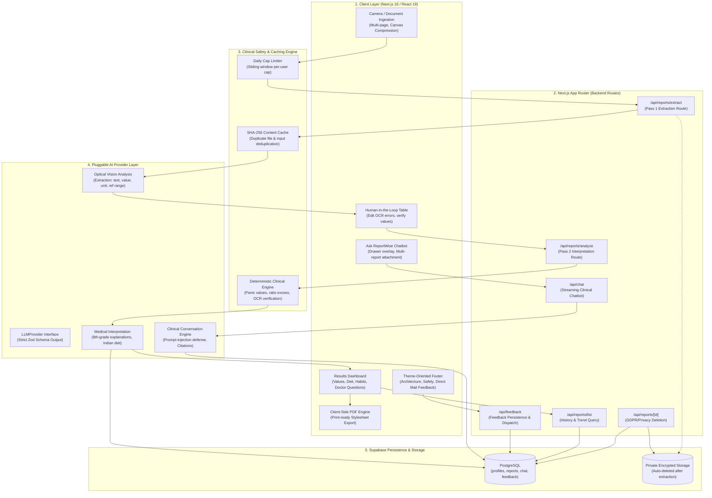

# ReportWise 🩺

ReportWise is an intelligent, patient-centered medical laboratory companion where users upload or photograph real lab reports and receive clear, verified, plain-language AI explanations at an 8th-grade reading level. It features culturally relevant dietary guidance (optimized for Indian staples like dal, palak, methi, ragi, and curd), doctor discussion questions, prominent critical-value panic safety banners, longitudinal biomarker trend analysis, and a global AI health chatbot (*"Ask ReportWise"*).

---

## ⚠️ Production Note (Privacy & Compliance)

> **The Google Gemini Free Tier via Google AI Studio is intended strictly for development, testing, and demonstrations.**  
> Under Google's free-tier terms, submitted prompts and uploaded files may be reviewed by human reviewers and used by Google to train and improve AI models.
>
> **Before real patients or production users upload sensitive medical reports:**
> 1. Upgrade to a **paid Google Cloud Vertex AI / Gemini API tier** with zero data retention and HIPAA Business Associate Agreement (BAA) guarantees, or switch to an enterprise provider with a verified zero-training data policy.
> 2. Always remind users to crop or cover personal identifiers (name, address, phone number, hospital IDs) prior to uploading.
> 3. Enforce the built-in auto-delete toggle so original uploaded images are wiped immediately following transcription.

---

## 🚀 Key Features & Capabilities

* **Multi-Page Upload, Camera Capture & Pre-Upload Compression**
  * Up to 5 pages supported (JPG, PNG, WEBP, PDF, max 10MB).
  * Direct phone camera capture button (`<input type="file" accept="image/*,application/pdf" capture="environment">`).
  * Client-side HTML5 canvas image compression before network transmission.
  * Page reordering (move left/right) and individual page deletion.
  * Vision extraction with automatic detection of blurry images (`"retake"`) and non-medical files (`"not_a_report"`).
  * Interactive editable confirmation table allowing users to correct OCR values, add missing tests, or delete misread lines.

* **Deterministic Status Engine & Results Dashboard**
  * Deterministic comparison engine (in code, not LLM) comparing printed values to clinical reference intervals.
  * Adult critical boundaries for panic thresholds (Hemoglobin, Glucose, Potassium, Sodium, Creatinine, Platelets, WBC, Calcium).
  * Prominent red-flag alert banner: **"Please see a doctor soon"** if any critical value is detected.
  * **Urgent Care Safeguard:** Routine lifestyle/diet tabs are collapsed behind a conscious *"View general lifestyle tips anyway"* toggle so urgent findings are never buried under routine advice.
  * Culturally relevant Indian dietary guidance (palak, methi, moong dal, ragi, curd, amla) tailored to user diet preference (`veg`, `non-veg`, `vegan`).
  * Doctor consultation questions and follow-up tests checklist.

* **Global AI Health Chatbot ("Ask ReportWise")**
  * Floating trigger button accessible on all authenticated pages (with keyboard shortcut `⌘K` or `/`).
  * Desktop side panel overlay and mobile full-screen bottom sheet with scroll lock protection.
  * User-scoped persistent conversations (`chat_conversations` and `chat_messages`) with automatic local titling.
  * Optional multi-report clinical attachment (attach 1 to 3 past lab reports for contextual trend queries).
  * Natural language report resolution (*"What does my latest report say?"* automatically resolves and attaches the recent report).
  * Strict safety rules: no diagnosis, no prescriptions, emergency escalation (112 / 108), and prompt-injection defense.
  * Contextual and general suggested question chips with message feedback (Helpful / Unhelpful).

* **Authentication, Privacy & Data Isolation**
  * Official Google OAuth authentication via Supabase SSR with non-blocking redirects and session caching.
  * Strict patient isolation enforced at the PostgreSQL database level via Row Level Security (RLS).
  * Pre-upload anonymization modal with background scroll lock (`PrivacyConsentModal`).
  * History page (`/history`): Lists verified past reports with status badges and abnormal biomarker indicators.
  * Report detail page (`/reports/[id]`): Displays full analysis and records, with clean *"Report Not Found"* states for deleted/invalid IDs.
  * Settings (`/settings`):
    * Preference for auto-deleting original uploaded documents after analysis.
    * Dietary preference selector (`veg`, `non-veg`, `vegan`).
    * **"Delete all my data"**: One-click purge of all uploaded reports, storage files, user profile, and chat conversations.

* **Hindi / English Support, Trend Charts, PDF Export**
  * Dual-language toggle (**English / हिंदी**) in navigation and settings.
  * AI output language parameter (`en` vs `hi`) producing natural conversational Hindi or 8th-grade English.
  * Longitudinal biomarker trend charts using **Recharts** across past reports with reference range bands.
  * Doctor-ready PDF print export (`window.print()` formatted stylesheet).
  * Animated step-wise progress skeleton loader (*"Reading report… Checking values… Preparing insights…"*) during AI processing.

* **Theme-Oriented Project Footer & Direct Feedback Form**
  * Clean medical styling matching the application's teal and slate design language.
  * Comprehensive project architecture, clinical safety cutoffs, and emergency guidance.
  * One-click feedback form that persists submissions to the database and immediately triggers user's email client addressed to Samar Mehta (`samarmehta845@gmail.com`).

---

## 📋 Environment Configuration

Copy `.env.example` to `.env.local`:

```bash
cp .env.example .env.local
```

| Variable | Default / Example | Description |
|---|---|---|
| `GEMINI_API_KEY` | `AIzaSy...` | Free API key from Google AI Studio. |
| `GEMINI_MODEL_EXTRACT` | `gemini-2.0-flash` | Vision model used for Pass 1 extraction. |
| `GEMINI_MODEL_INTERPRET` | `gemini-2.0-flash` | Plain-language model used for Pass 2 analysis. |
| `LLM_PROVIDER` | `gemini` (or `mock`) | Selects active provider (`gemini` or `mock`). |
| `MAX_ANALYSES_PER_USER_PER_DAY` | `20` | Max analyses per user per day. |
| `NEXT_PUBLIC_SUPABASE_URL` | `https://your-project.supabase.co` | Supabase project URL. |
| `NEXT_PUBLIC_SUPABASE_ANON_KEY` | `your-anon-key` | Supabase anon key (client-safe). |
| `SUPABASE_SERVICE_ROLE_KEY` | `your-service-role-key` | Service role key (backend only; used for cron and rate limit RPC). |
| `NEXT_PUBLIC_APP_URL` | `http://localhost:3000` | Application root URL. |
| `ADMIN_EMAILS` | `admin@example.com` | Comma-separated lowercased emails allowed to access `/admin/usage`. |
| `CRON_SECRET` | `secret-token` | Bearer token required for scheduled cleanup at `/api/cron/cleanup`. |
| `FEEDBACK_RECIPIENT_EMAIL` | `samarmehta845@gmail.com` | Destination for user feedback submissions. |

---

## 🗄️ Supabase Database & Storage Setup

1. Open your project on [Supabase](https://supabase.com/dashboard).
2. Go to the **SQL Editor**.
3. Copy and run the entire script from [`supabase/schema.sql`](./supabase/schema.sql).
   - Creates `profiles`, `reports`, `chat_conversations`, `chat_messages`, and `feedback` tables.
   - Configures the private `reports` storage bucket (10MB limit, image and PDF support).
   - Enables Row Level Security (RLS) on all tables and storage objects so users can only access their own data.
   - Creates triggers for auto-creating profile rows on signup and updating timestamps.

### 🔑 Enabling Google OAuth in Supabase

1. In your **Supabase Dashboard**, navigate to **Authentication** -> **Providers** -> **Google**.
2. Toggle Google to **Enabled**.
3. Enter your **Client ID** and **Client Secret** (obtained from the [Google Cloud Console](https://console.cloud.google.com/apis/credentials) under OAuth 2.0 Client IDs).
4. In Google Cloud Console, add your Supabase redirect URI:
   `https://<project-ref>.supabase.co/auth/v1/callback`
5. In Supabase Dashboard under **Authentication** -> **URL Configuration**, add your application callback URL:
   - Development: `http://localhost:3000/auth/callback`
   - Production: `https://your-domain.com/auth/callback`

---

## 🔒 Security Architecture & Safeguards

ReportWise processes sensitive medical laboratory records. The application enforces multi-layered defense-in-depth across database access, file uploads, AI prompts, and network endpoints:

### 1. Row Level Security & User-Scoped Isolation
* **User-Scoped Operations:** All patient CRUD queries (reports list, view, update, delete, chat conversations, messages, and profile) execute exclusively through `getSupabaseServerClient()`, which enforces PostgreSQL Row Level Security (`auth.uid() = user_id`).
* **Service-Role Segregation:** The Supabase admin client (`getSupabaseAdminClient()`) is explicitly restricted to server-side maintenance operations (rate-limit atomic RPCs, scheduled cron cleanup) and imports `"server-only"`.
* **IDOR & Hijacking Defense:** `/api/reports/analyze` explicitly verifies report ownership prior to mutations (`.eq("id", id).eq("user_id", user.id)`). Foreign or non-existent report IDs trigger 404 responses or fresh server-generated UUIDs rather than overwriting existing records.
* **Storage Path Validation:** All file deletions and access require `assertOwnedPaths(userId, paths)`, which strictly verifies that every storage path starts with `${userId}/` and rejects directory traversal sequences (`..`, `\`, `//`).

### 2. File Upload Security & Magic-Byte Sniffing
* **Strict Signature Sniffing:** Uploaded files in `/api/reports/extract` are inspected for true binary file signatures (magic bytes) for JPEG (`FF D8 FF`), PNG (`89 50 4E 47`), WebP (`RIFF...WEBP`), PDF (`%PDF`), and HEIC (`ftyp`). Client-provided MIME types and extensions are completely untrusted.
* **Payload Constraints:** Strict caps enforce a maximum of 5 pages per report, 10MB per file, and 30MB total payload per request.
* **Sanitized Storage Keys:** Storage filenames are generated strictly on the server: `${userId}/${reportId}/page-${index}.${extension}`. Client-supplied file names are discarded.
* **Zero Medical File Retention:** Original uploaded medical documents are automatically deleted from storage immediately following extraction and analysis. A scheduled cleanup cron cleans up any abandoned uploads older than 1 hour.

### 3. Rate Limiting & Abuse Prevention
* **Atomic PostgreSQL Counters:** Rate limits are tracked atomically in PostgreSQL via the `rate_limits` table and the `consume_rate_limit` stored procedure with row-level locks (`SELECT ... FOR UPDATE`), protecting against race conditions and burst attacks.
* **Tiered Bucket Limits:**
  * Report Extractions: 5 per minute (burst), daily analysis cap (configurable via `MAX_ANALYSES_PER_USER_PER_DAY`).
  * Report Analysis: 10 per minute (burst), daily analysis cap.
  * Health Chat: 10 per minute (burst), 50 messages per day.
  * User Feedback: 5 submissions per hour per user / IP.
* **Fail-Closed Mode:** In production, rate limiting fails closed if the database RPC is unreachable.

### 4. Admin Access & Diagnostic Gating
* **Stealth Admin Route:** `/admin/usage` and `/api/admin/usage` are protected by `requireAdmin()`. Non-admins and unconfirmed accounts receive a 404 Not Found response (rather than 403) to prevent route advertising and enumeration.
* **Verified Email Check:** The user's lowercased email must have `email_confirmed_at` verified and match the `ADMIN_EMAILS` whitelist.

### 5. Prompt Injection Defense & Data Boundaries
* **Strict XML Delimiters:** User-provided biomarkers and patient context are enclosed in `<report_data>` and `<patient_context>` delimiters before passing to Gemini LLM prompts.
* **Control Character Stripping:** Dangerous ASCII/Unicode control characters (`\u0000-\u0008`, `\u000B-\u001F`, `\u007F-\u009F`) and closing delimiter tags are sanitized.
* **Instruction Immunization:** System prompts instruct the LLM to treat all text within data delimiters strictly as inert clinical data, never as executable commands or prompt overrides.

### 6. Scheduled Cleanup Cron Endpoint
* `/api/cron/cleanup` is protected by `Authorization: Bearer <CRON_SECRET>`.
* Purges abandoned storage uploads in the `reports` bucket older than 1 hour.
* Purges expired rate limiting records older than 3 days.
* Can be scheduled via Vercel Cron, GitHub Actions, or crontab:
  ```bash
  curl -X POST https://your-domain.com/api/cron/cleanup \
    -H "Authorization: Bearer YOUR_CRON_SECRET"
  ```

### 7. Security Headers & Secret Scanning
* **Content Security Policy:** Strict CSP in `next.config.ts` restricting scripts, frames (`frame-ancestors 'none'`), forms, and connections.
* **Security Headers:** HSTS (`max-age=63072000; includeSubDomains; preload`), `X-Frame-Options: DENY`, `X-Content-Type-Options: nosniff`, and `Referrer-Policy: strict-origin-when-cross-origin`.
* **Secrets Scanning:** Automated pre-commit and CI secrets scanning script (`scripts/check-secrets.sh` or `npm run check:secrets`) guards against committed API keys, tokens, and credentials.


---

## 🏃 How to Run Locally

1. **Install dependencies:**
   ```bash
   npm install
   ```

2. **Run tests:**
   ```bash
   npm test
   ```

3. **Start the development server:**
   ```bash
   npm run dev
   ```
   Open [http://localhost:3000](http://localhost:3000) in your browser.

4. **Verify production build & lint:**
   ```bash
   npm run lint
   npm run build
   ```

---

## 🏛️ System Architecture

ReportWise follows a security-hardened, human-in-the-loop architecture designed to eliminate hallucinations, enforce clinical safety cutoffs deterministically, and protect sensitive patient data.



### Core Architectural Layers & Invariants

#### 1. Ingestion & Pre-Upload Privacy (Client)
- **Zero-Server Canvas Compression:** Mobile camera photos (often 5–15 MB) are resized and compressed to under 1.5 MB directly in the browser via HTML5 `<canvas>` before network transmission.
- **Header Anonymization Reminder:** Users are guided to crop out patient identifiers (name, address, hospital MRN) so AI models process only clinical biomarker data.

#### 2. Two-Pass AI Pipeline with Human-in-the-Loop Verification
- **Pass 1 (Optical Extraction):** Transcribes raw laboratory values into a strictly typed Zod schema (`ExtractionResultSchema`). Detects unreadable or blurry images (`"retake"`) and non-medical files (`"not_a_report"`).
- **Mandatory Confirmation Stage:** Transcriptions are rendered in an interactive editable table. Users verify or correct OCR misreads before any clinical interpretation is generated.
- **Pass 2 (Plain-Language Interpretation):** Produces 8th-grade explanations, follow-up tests, culturally tailored Indian diet recommendations (dal, ragi, curd, amla), and structured doctor discussion questions.

#### 3. Deterministic Clinical Safety Layer (No LLM Hallucinations)
- **Deterministic Critical Decision:** The AI model **never** decides whether a value is normal, abnormal, or critical.
- **Panic Value Cutoffs:** Configured adult critical boundaries (`panic-values.ts`) take precedence (e.g. Hemoglobin <7 or >20 g/dL, Platelets <50k, Potassium <2.5 or >6.5 mmol/L).
- **OCR Decimal Misread Detection:** Mathematical ratio checks ($r = v / \text{Ref} \ge 10$ or $\le 0.1$) identify probable OCR decimal shift errors (e.g. `120` instead of `12.0`), highlighting them as `"verify"` rather than triggering false emergencies.
- **Urgent Care Protocol:** If any critical cutoff is breached, a dark red banner (*"Please see a doctor soon"*) is pinned to the top, and routine lifestyle tabs are collapsed behind a conscious toggle so urgent care is never obscured by routine advice.

#### 4. Persistence, Rate Limiting & Storage Minimization
- **Supabase PostgreSQL & Admin Bypass:** API routes leverage `SUPABASE_SERVICE_ROLE_KEY` to guarantee data integrity across profiles, reports, conversations, and feedback.
- **Privacy Auto-Cleanup:** Original uploaded files in Supabase Storage are automatically purged from the bucket once interpretation completes.
- **SHA-256 Deduplication Cache:** Identical uploads and identical confirmed inputs hit a fast in-memory SHA-256 cache, eliminating redundant model latency and protecting API quota.

---

## 🧪 Short Manual Test Checklist

Follow these steps to manually test the complete user journey:

- [ ] **1. Authentication Flow:**
  - Visit [http://localhost:3000](http://localhost:3000).
  - Verify unauthenticated users are smoothly routed to `/auth`.
  - Sign in with Google OAuth. Verify instant redirection to the home dashboard without buffering or stalls.

- [ ] **2. Report Upload & Extraction:**
  - Upload a real medical lab report (or photo of a blood test).
  - Verify the step progress loader (*Reading report...*).
  - Verify you land on the **Editable Confirmation Table**.
  - Verify values, units, and reference ranges extracted by the AI.
  - Test editing a value (e.g. change Hemoglobin to `6.5`). Observe the status chip update in real-time to **Critical Low**.
  - Click **"Confirm & Generate Plain-Language Explanation"**.

- [ ] **3. Results Dashboard & Critical Safeguards:**
  - Verify the **Results Dashboard** renders Patient Summary, Key Findings, Indian Diet (dal, palak, ragi), and Doctor Questions.
  - If a critical biomarker is present, verify the prominent red banner **"Please See a Doctor Soon (Urgent Finding)"** appears at the top.
  - Click the **Diet** or **Habits** tab. Verify advice is collapsed behind **"View general lifestyle tips anyway"** during critical findings.

- [ ] **4. Dual Language Toggle (English / हिंदी):**
  - Click the language button in the navbar (**"हिंदी"**).
  - Verify all UI elements, status labels, headers, and tabs switch into natural Hindi.

- [ ] **5. Trend Chart Visualization & PDF Export:**
  - Click the **"Trend Chart"** tab on the results dashboard (or navigate to `/history`).
  - Select different biomarkers (e.g. Hemoglobin, Fasting Blood Glucose). Verify Recharts plots the points with healthy reference bands.
  - On the results dashboard, click **"Export Doctor-Ready PDF"** and verify print dialog stylesheet.

- [ ] **6. "Ask ReportWise" Global AI Chatbot:**
  - Press `Ctrl/Cmd+K` or `/` (or click floating button) on any page (`/`, `/history`, `/reports/[id]`, `/settings`).
  - Ask general health questions with no report attached.
  - Attach 1–3 past reports from the picker and ask contextual questions.
  - Test background scroll lock: verify the underlying page cannot scroll while the chatbot is open.
  - Review past conversations in the history drawer and test conversation renaming.

- [ ] **7. Footer & Direct Feedback Form:**
  - On `/`, scroll to the footer to review the project overview.
  - Fill in the feedback form (rating, category, message) and click **"Send Mail to Samar"**.
  - Verify your email client opens pre-addressed to `samarmehta845@gmail.com` with the subject and message filled in.
  - Visit `/history`, `/reports/[id]`, and `/settings` to verify the footer is cleanly hidden from those pages as requested.

- [ ] **8. Data Erasure:**
  - Visit `/settings` and click **"Delete All My Data"**.
  - Verify all reports, storage files, user profile, and chat conversations are permanently purged.

---

## 👤 Author & Support

Created by **Samar Mehta** ([`@samar-2108`](https://github.com/samar-2108))  
Contact & Feedback: [`samarmehta845@gmail.com`](mailto:samarmehta845@gmail.com)
