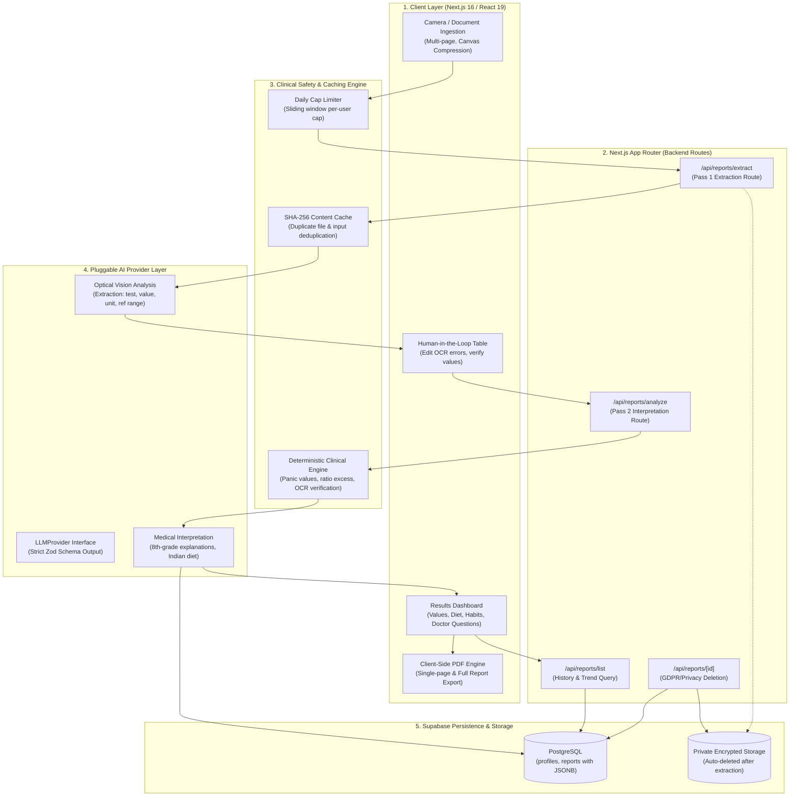

# ReportWise 🩺

ReportWise is an intelligent, patient-centered web application where users upload or photograph medical lab reports and receive clear, verified, plain-language AI explanations at an 8th-grade reading level. It features culturally relevant dietary guidance (optimized for Indian staples like dal, leafy greens, ragi, and curd), doctor discussion questions, prominent critical-value safety banners, and biomarker trend analysis across reports.

---

## ⚠️ Production Note (Privacy & Compliance)

> **The Google Gemini Free Tier via Google AI Studio is intended strictly for development, testing, and demonstrations.**  
> Under Google's free-tier terms, submitted prompts and uploaded files may be reviewed by human reviewers and used by Google to train and improve AI models.
>
> **Before real patients or production users upload sensitive medical reports:**
> 1. Upgrade to a **paid Google Cloud Vertex AI / Gemini API tier** with zero data retention and HIPAA Business Associate Agreement (BAA) guarantees, or switch to an enterprise provider with a verified zero-training data policy.
> 2. Always remind users to crop or cover personal identifiers (name, address, phone number, hospital IDs) prior to uploading.
> 3. Enforce the built-in auto-delete toggle so original uploaded images are wiped immediately following transcription.

---

## 🚀 Features by Phase

* **Phase 1: Architecture & Data Layer**
  * Next.js 16 (App Router) + TypeScript + Tailwind CSS with calm medical theme.
  * Supabase PostgreSQL schema with `profiles`, `reports`, RLS policies, and private encrypted storage bucket.
  * Zod schemas for Pass 1 extraction (`ExtractionResultSchema`) and Pass 2 interpretation (`InterpretationResultSchema`).
  * Pluggable LLM Provider abstraction (`src/lib/llm/`) with Google Gemini (`@google/genai`) and Mock provider.

* **Phase 2: Multi-Page Upload, Camera & Editable Confirmation**
  * Up to 5 pages supported (JPG, PNG, WEBP, PDF, max 10MB).
  * Phone camera capture button (`<input type="file" accept="image/*,application/pdf" capture="environment">`).
  * Client-side HTML5 canvas image compression before upload.
  * Page reordering (move left/right) and page removal.
  * 1-Click test fixtures (CBC, Lipid, Critical Panel) for zero-camera instant testing.
  * Pass 1 Vision extraction with automatic detection of blurry images (`"retake"`) and non-medical files (`"not_a_report"`).
  * Interactive editable confirmation table allowing users to correct OCR mistakes, add missing tests, or delete misread lines.

* **Phase 3: Deterministic Status Engine & Results Dashboard**
  * Deterministic engine (in code, not LLM) comparing printed values to reference intervals.
  * Clinical safety cutoffs config for critical thresholds (Hemoglobin, Glucose, Potassium, Sodium, Creatinine, Platelets, WBC, Calcium).
  * Prominent red-flag alert banner: **"Please see a doctor soon"** if any critical value is detected.
  * **Urgent Care Safeguard:** Routine lifestyle/diet tabs are collapsed behind a conscious *"View general lifestyle tips anyway"* toggle so urgent findings are never buried under routine advice.
  * Culturally relevant Indian dietary guidance (palak, methi, moong dal, ragi, curd, amla) tailored to user diet preference (`veg`, `non-veg`, `vegan`).
  * Doctor consultation questions and follow-up tests checklist.

* **Phase 4: Auth, History, Storage Lifecycle & Privacy**
  * Supabase Auth: Email + Google OAuth sign-in (`/auth`).
  * History page (`/history`): Lists past reports with status badges and critical alert indicators.
  * Report detail page (`/reports/[id]`): Displays full analysis and past records.
  * Single report deletion: Removes database row and wipes storage files.
  * Settings (`/settings`):
    * Preference for auto-deleting original uploaded documents after analysis.
    * Dietary preference selector.
    * **"Delete all my data"**: One-click purge of all uploaded reports, storage files, and user profile.
  * Per-user daily analysis cap (`MAX_ANALYSES_PER_USER_PER_DAY`, default 3).
  * SHA-256 duplicate report caching to avoid wasting API quota.

* **Phase 5: Hindi / English Support, Trend Charts, PDF Export**
  * Dual-language toggle (**English / हिंदी**) in navigation and settings.
  * AI output language parameter (`en` vs `hi`) producing natural conversational Hindi or 8th-grade English.
  * Longitudinal biomarker trend charts using **Recharts** across past reports with reference range bands.
  * Doctor-ready PDF print export (`window.print()` formatted stylesheet).
  * Animated step-wise progress skeleton loader (*"Reading report… Checking values… Preparing insights…"*) during AI processing.
  * Hidden diagnostic quota monitor at [`/admin/usage`](http://localhost:3000/admin/usage).

---

## 📋 Environment Configuration

Copy `.env.example` to `.env.local`:

```bash
cp .env.example .env.local
```

| Variable | Default / Example | Description |
|---|---|---|
| `GEMINI_API_KEY` | `AIzaSy...` | Free API key from Google AI Studio. |
| `GEMINI_MODEL_EXTRACT` | `gemini-2.0-flash` | Vision model used for Pass 1 extraction. |
| `GEMINI_MODEL_INTERPRET` | `gemini-2.0-flash` | Fast model used for Pass 2 plain-language analysis. |
| `LLM_PROVIDER` | `gemini` (or `mock`) | Selects active provider. Set to `mock` to test without consuming quota. |
| `MAX_ANALYSES_PER_USER_PER_DAY` | `20` | Max analyses per user per day. |
| `NEXT_PUBLIC_SUPABASE_URL` | `https://your-project.supabase.co` | Supabase project URL. |
| `NEXT_PUBLIC_SUPABASE_ANON_KEY` | `your-anon-key` | Supabase anon key. |
| `SUPABASE_SERVICE_ROLE_KEY` | `your-service-role-key` | Optional backend admin key for database cleanups. |
| `NEXT_PUBLIC_APP_URL` | `http://localhost:3000` | Application root URL. |

---

## 🗄️ Supabase Database & Storage Setup

1. Open your project on [Supabase](https://supabase.com/dashboard).
2. Go to the **SQL Editor**.
3. Copy and run the entire script from [`supabase/schema.sql`](./supabase/schema.sql).
   - Creates `profiles` and `reports` tables.
   - Configures the private `reports` bucket (10MB limit, image and PDF support).
   - Enables Row Level Security (RLS) on tables and storage objects so users can only access their own data.
   - Creates triggers for auto-creating profile rows on signup and updating timestamps.

### 🔑 Enabling Google OAuth in Supabase

1. In your **Supabase Dashboard**, navigate to **Authentication** -> **Providers** -> **Google**.
2. Toggle Google to **Enabled**.
3. Enter your **Client ID** and **Client Secret** (obtained from the [Google Cloud Console](https://console.cloud.google.com/apis/credentials) under OAuth 2.0 Client IDs).
4. In Google Cloud Console, add your Supabase redirect URI:
   `https://<project-ref>.supabase.co/auth/v1/callback`
5. In Supabase Dashboard under **Authentication** -> **URL Configuration**, add your application callback URL:
   - Development: `http://localhost:3000/auth/callback`
   - Production: `https://your-domain.com/auth/callback`

---

## 🏃 How to Run Locally

1. **Install dependencies:**
   ```bash
   npm install
   ```

2. **Run tests:**
   ```bash
   npm run test:llm
   ```

3. **Start the development server:**
   ```bash
   npm run dev
   ```
   Open [http://localhost:3000](http://localhost:3000) in your browser.

4. **Verify production build & lint:**
   ```bash
   npm run lint
   npm run build
   ```

---

## 🏛️ System Architecture

ReportWise follows a security-hardened, human-in-the-loop architecture designed to eliminate hallucinations, enforce clinical safety cutoffs deterministically, and protect sensitive patient data.



### Core Architectural Layers & Invariants

#### 1. Ingestion & Pre-Upload Privacy (Client)
- **Zero-Server Canvas Compression:** Mobile camera photos (often 5–15 MB) are resized and compressed to under 1.5 MB directly in the browser via HTML5 `<canvas>` before network transmission.
- **Header Anonymization Reminder:** Users are guided to crop out patient identifiers (name, address, hospital MRN) so AI models process only clinical biomarker data.

#### 2. Two-Pass AI Pipeline with Human-in-the-Loop Verification
- **Pass 1 (Optical Extraction):** Transcribes raw laboratory values into a strictly typed Zod schema (`ExtractionResultSchema`). Detects unreadable or blurry images (`"retake"`) and non-medical files (`"not_a_report"`).
- **Mandatory Confirmation Stage:** Transcriptions are rendered in an interactive editable table. Users verify or correct OCR misreads before any clinical interpretation is generated.
- **Pass 2 (Plain-Language Interpretation):** Produces 8th-grade explanations, follow-up tests, culturally tailored Indian diet recommendations (dal, ragi, curd, amla), and structured doctor discussion questions.

#### 3. Deterministic Clinical Safety Layer (No LLM Hallucinations)
- **Deterministic Critical Decision:** The AI model **never** decides whether a value is normal, abnormal, or critical.
- **Panic Value Cutoffs:** Configured adult critical boundaries (`panic-values.ts`) take precedence (e.g. Hemoglobin <7 or >20 g/dL, Platelets <50k, Potassium <2.5 or >6.5 mmol/L).
- **OCR Decimal Misread Detection:** Mathematical ratio checks ($r = v / \text{Ref} \ge 10$ or $\le 0.1$) identify probable OCR decimal shift errors (e.g. `120` instead of `12.0`), highlighting them as `"verify"` rather than triggering false emergencies.
- **Urgent Care Protocol:** If any critical cutoff is breached, a dark red banner (*"Please see a doctor soon"*) is pinned to the top, and routine lifestyle tabs are collapsed behind a conscious toggle so urgent care is never obscured by routine advice.

#### 4. Persistence, Rate Limiting & Storage Minimization
- **Supabase PostgreSQL & Admin Bypass:** API routes leverage `SUPABASE_SERVICE_ROLE_KEY` to guarantee data integrity across profiles and reports.
- **Privacy Auto-Cleanup:** Original uploaded files in Supabase Storage are automatically purged from the bucket once interpretation completes.
- **SHA-256 Deduplication Cache:** Identical uploads and identical confirmed inputs hit a fast in-memory SHA-256 cache, eliminating redundant model latency and protecting API quota.

---

## 🧪 Short Manual Test Checklist

Follow these steps to manually test the complete user journey:

- [ ] **1. Instant Demo / Sample Flow:**
  - Visit the homepage [http://localhost:3000](http://localhost:3000).
  - Under *"Or test instantly with a pre-loaded sample report"*, click **"Sample CBC"**.
  - Notice the step progress loader (*Reading report...*).
  - Verify you land on the **Editable Confirmation Table**.
  - Edit a value (e.g. change Hemoglobin from `9.8` to `6.5`). Observe the status chip update in real-time to **Critical Low** with a pulse badge.
  - Click **"Confirm & Generate Plain-Language Explanation"**.
  - Notice the step loader (*Checking values... Preparing insights...*).
  - Verify the **Results Dashboard** renders with Patient Summary, Key Findings, Culturally Relevant Indian Diet (dal, palak, ragi), and Doctor Questions.

- [ ] **2. Critical Alert & Lifestyle Collapse Safeguard:**
  - Go back and click **"Sample Critical Panel"** (or change Potassium to `6.8` / Glucose to `340`).
  - Confirm the report.
  - Verify that the prominent red banner **"Please See a Doctor Soon (Urgent Finding)"** appears at the top.
  - Click the **Diet** or **Habits** tab. Verify the advice is collapsed behind **"View general lifestyle tips anyway"** so urgent findings are never buried under routine tips.

- [ ] **3. Dual Language Toggle (English / हिंदी):**
  - Click the language button in the navbar (**"हिंदी"**).
  - Verify all UI elements, status labels, headers, and tabs switch into natural Hindi.

- [ ] **4. Trend Chart Visualization:**
  - Click the **"Trend Chart"** tab on the results dashboard (or navigate to `/history`).
  - Select different biomarkers (e.g. Hemoglobin, Fasting Blood Glucose).
  - Verify Recharts plots the points with healthy reference bands.

- [ ] **5. PDF Export:**
  - On the results dashboard, click **"Export Doctor-Ready PDF"**.
  - Verify the browser print dialog opens with a clean, print-optimized stylesheet.

- [ ] **6. History & Data Purge:**
  - Visit `/history` to review recorded past reports.
  - Visit `/settings` to test saving dietary preferences and testing **"Delete All My Data"**.
  - Visit `/admin/usage` to inspect live Gemini calls, cache hits, and daily quota consumption.
